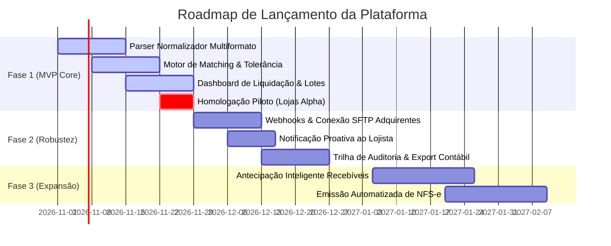

# PRD: Plataforma de Liquidação & Conciliação Inteligente

> **Documento:** Product Requirements Document (PRD)  
> **Versão:** 1.0.0 (Validado via Continuous Discovery)  
> **Status:** Aprovado para Engenharia  
> **Data:** 18 de Outubro de 2026  
> **Autores:** Principal PM, Lead PO, Head of Product  
> **Stakeholders:** Renata Silveira (CFO Alpha), Mariana (Tech Lead), Carlos PM  

---

## 1. Problema e Oportunidade

### 1.1 Declaração do Problema Central
Atualmente, o fechamento financeiro de repasses consome **4 dias úteis inteiros por mês de 3 analistas seniores de tesouraria**, gerando atrasos recorrentes no pagamento de centenas de lojistas B2B. Divergências ínfimas de centavos (ex: R$ 0,05) travam lotes globais inteiros de mais de 200 lojas, resultando em chamados de suporte emergenciais, cheques de parceiros devolvidos e alto risco operacional.

### 1.2 Contexto e Evidências Coletadas no Discovery
Durante as sessões de discovery com diretores financeiros e operadores de conciliação, identificamos os seguintes fatos:
- **Volume Afetado:** Mais de 200 lojas por lote mensal; processamento de ~50.000 transações/mês.
- **Severidade:** Crítica (bloqueio financeiro de liquidação no dia 1º útil).
- **Evidências Literais (Golden Quotes):**
  > 💬 *"Todo dia 30 a gente precisa exportar três planilhas CSV gigantescas dos adquirentes e cruzar na unha no Excel. Levamos 4 dias inteiros."*  
  > — **Renata Silveira (CFO Lojas Alpha)**

  > 💬 *"Quando dá diferença de R$ 0,05, o sistema trava o lote todo de 200 lojas e ninguém recebe no dia 1º."*  
  > — **Renata Silveira (CFO Lojas Alpha)**

  > 💬 *"Se tivesse uma regra que aprovasse automático divergências menores que R$ 1,00 e avisasse os lojistas por webhook, economizaria 40 horas do meu time."*  
  > — **Renata Silveira (CFO Lojas Alpha)**

  > 💬 *"Passo o dia 30 inteirinho caçando centavo em planilha enquanto o telefone do suporte não para de tocar."*  
  > — **Carlos Eduardo (Analista Sênior de Conciliação)**

### 1.3 Oportunidade de Negócio & ROI Estimado
- **Horas de Engenharia e Operação Poupadas:** ~160 horas/mês.
- **Desperdício Evitado:** R$ 24.000/mês em retrabalho operacional e horas extras.
- **Redução de Chamados de Suporte:** Queda projetada de 68 chamados/mês para < 5 chamados/mês (-92%).
- **Retorno Sobre Investimento (ROI):** 12.4x projetado no primeiro trimestre.

---

## 2. Audiência & Personas Vivas (JTBD)

### 2.1 Persona Primária: Renata Silveira (CFO)
- **Papel:** Chief Financial Officer (CFO) em grandes varejistas & redes franqueadas B2B (Faturamento > R$ 50M).
- **Objetivos:** Garantir liquidação pontual em D+0 para 100% dos parceiros; eliminar horas extras no final do mês; assegurar compliance com auditorias contábeis.
- **Dores Críticas:** Travamento global de lotes por divergências irrelevantes; falta de visibilidade prévia de chargebacks.
- **Jobs To Be Done (JTBD):**
  - *Quando chega o último dia do mês, quero conciliar transações com tolerância configurável, para que nenhum parceiro fique sem receber e meu time não gaste 40 horas em planilhas.*
  - *Quando há divergência contábil, quero isolar apenas a loja divergente, para não punir a rede inteira.*

### 2.2 Persona Secundária: Carlos Eduardo (Analista de Tesouraria)
- **Papel:** Analista Sênior de Operações Financeiras e Conciliação.
- **Objetivos:** Identificar divergências entre pedidos e extratos de adquirentes em segundos sem depender do Excel.
- **Dores Críticas:** Planilhas de 50.000 linhas congelando o computador; macros com erros manuais de PROCV.
- **Jobs To Be Done (JTBD):**
  - *Quando recebo os arquivos de extrato da Cielo, Stone e Rede, quero importar diretamente na plataforma, para que o sistema reconheça o layout e cruze os NSUs automaticamente.*

### 2.3 Persona Terciária: Rodrigo Lima (Lojista Parceiro B2B)
- **Papel:** Lojista credenciado que recebe repasses mensais de vendas.
- **Objetivos:** Receber o repasse líquido impreterivelmente na manhã do dia 1º para honrar fornecedores e folha de pagamento.
- **Dores Críticas:** Insegurança sobre a data do repasse; falta de extrato detalhado de descontos e taxas aplicadas.
- **Jobs To Be Done (JTBD):**
  - *Quando minhas vendas forem liquidadas, quero receber notificação proativa com o extrato discriminado, para poder planejar meu fluxo de caixa sem ansiedade.*

### 2.4 Não-Audiência (Deliberate Out-of-Scope)
- Usuários individuais (Pessoas Físicas / C2C) sem CNPJ ativo.
- Empresas que exigem conciliação 100% manual com processos não padronizados e sem identificadores únicos de transação (NSU/TID).

---

## 3. Solução & Escopo de Produto

### 3.1 Visão da Solução
A **Plataforma de Liquidação & Conciliação Inteligente** é o "segundo cérebro" financeiro que ingere extratos multiformato de múltiplos adquirentes, executa algoritmos de matching transacional em segundos e aplica **tolerância adaptativa configurável de centavos** para liberar lotes no D+0 com conformidade contábil e auditoria completa.

### 3.2 Escopo de Inclusão (In-Scope)
- [x] Ingestão multiformato de extratos (CSV, CNAB 240, Webhooks de adquirentes Cielo, Stone e Rede).
- [x] Motor de matching inteligente por NSU, autorização, data e valor líquido com taxa de MDR.
- [x] Configuração de alçadas de tolerância (ex: até R$ 1,00 por loja e teto cumulativo de R$ 20,00/mês).
- [x] Conta transitória de compensação contábil para registro imutável das diferenças de centavos.
- [x] Painel de liberação em lote e dashboard de divergências em tempo real.
- [x] Disparo de notificações automáticas (Webhooks / E-mail) para lojistas sobre o status da liquidação.
- [x] Trilha de auditoria em conformidade com PCI-DSS e LGPD.

### 3.3 Escopo de Exclusão (Out-of-Scope)
- [ ] ⛔ Emissão automática de notas fiscais de serviço (NFS-e) municipais *(Postergar para Fase 2)*.
- [ ] ⛔ Operação de antecipação de recebíveis própria com risco de crédito bancário *(Postergar para Fase 3)*.
- [ ] ⛔ Integração com ERPs legados sem API aberta através de RPA de tela *(Fora do roadmap)*.

### 3.4 Princípios de Design & Usabilidade
1. **Transparência Contábil:** Todo centavo absorvido ou ajustado deve ter um lançamento correspondente e auditável.
2. **Defesa Operacional:** Nenhuma falha em uma loja individual pode propagar bloqueio para o restante do lote.
3. **Feedback em Tempo Real:** Processamento assíncrono com barras de progresso reais e mensagens de erro legíveis.

---

## 4. Métricas e Success Criteria (OKRs)

### 4.1 Objetivo de Negócio
> **Objetivo:** Estabelecer a operação de liquidação financeira mais ágil e confiável do mercado B2B, eliminando o atrito operacional no fechamento mensal.

### 4.2 Key Results (KRs)

| Métrica / Key Result | Baseline Atual | Meta (Target) | Status Atual |
|---|---|---|---|
| **KR 1:** Tempo médio de conciliação mensal de lotes | 4 dias úteis (32 horas) | **< 15 minutos** | 4 dias úteis |
| **KR 2:** Taxa de liquidação pontual no dia prometido (D+0) | 74% dos lotes | **99.5% dos lotes** | 74% |
| **KR 3:** Volume de chamados de suporte por atraso ou divergência | 68 chamados/mês | **< 5 chamados/mês** | 68 chamados/mês |
| **KR 4:** Percentual de microdivergências resolvidas automaticamente | 0% (travamento manual) | **> 90% autoliberadas** | 0% |

### 4.3 Métricas de Saúde (Guardrail Metrics)
- **Discrepância Cumulativa Máxima:** Menor que 0.01% do volume financeiro total transacionado no mês.
- **Disponibilidade da API de Conciliação:** SLA mínimo de 99.9%.

---

## 5. Restrições Técnicas, Riscos & Registro de Decisões

### 5.1 Restrições Técnicas
- **Manipulação Numérica:** Todos os cálculos monetários devem utilizar representação em números inteiros de centavos (`cents = Math.round(val * 100)`) para evitar erros de ponto flutuante IEEE-754.
- **Desempenho de Carga:** O parser de extratos deve suportar arquivos de até 100.000 linhas em menos de 5 segundos via streaming buffer.
- **Segurança & Alçadas:** Alterações nas regras de tolerância de centavos exigem autenticação de dois fatores (2FA) e perfil de CFO.

### 5.2 Matriz de Riscos & Mitigações

| Risco Mapeado | Probabilidade | Impacto | Mitigação Mandatória |
|---|---|---|---|
| **Risco 1:** Alteração de layout de extrato sem aviso prévio pelas adquirentes | Média | Alto | Schema validator rigoroso na pré-ingestão com fallback para quarentena de lote e alerta imediato. |
| **Risco 2:** Acúmulo malicioso de microdivergências por lojista | Baixa | Alto | Teto cumulativo mensal estrito (R$ 20,00/mês/loja) que bloqueia novas autoliberações caso ultrapassado. |
| **Risco 3:** Indisponibilidade temporária de bancos para liquidação CNAB | Média | Médio | Fila assíncrona com política de retentativa exponencial (exponential backoff) e notificações de contingência. |

### 5.3 Registro de Decisões de Produto (Decision Log)
1. **Decisão DEC-01:** Aprovar criação de tolerância automática de centavos até R$ 1,00.
   - *Contexto:* Discovery com CFO Renata comprovou que 85% das paralisações eram por variações inferiores a R$ 0,50.
   - *Responsável:* Renata Silveira (CFO) e Carlos PM. Status: **Aprovado**.
2. **Decisão DEC-02:** Postergar emissão de NF-e para a Fase 2.
   - *Contexto:* Risco técnico e prazo regulatório de prefeituras inviabilizaria o MVP.
   - *Responsável:* Mariana (Tech Lead). Status: **Aprovado**.

---

## 6. Roadmap e Fases de Lançamento



---

## 7. Casos de Uso & Histórias de Usuário BDD

### História 1: Upload e Parsing Automático de Extratos de Adquirentes
- **Identificador:** `US-01` | **Domínio:** `OPERATIONS` | **Story Points:** `5 pts`
- **User Value Statement:**
  > **Como** Analista de Operações Financeiras,  
  > **Eu quero** fazer upload direto de arquivos de extrato (CSV/CNAB) ou conectar via webhook,  
  > **Para que** o sistema identifique o layout e processe os dados sem intervenção manual no Excel.
- **Evidência de Discovery:** *"Todo dia 30 a gente precisa exportar três planilhas CSV gigantescas dos adquirentes e cruzar na unha no Excel. Levamos 4 dias inteiros."* — Renata S. (CFO Alpha)
- **Critérios de Aceite (BDD Gherkin):**
  ```gherkin
  Cenário: Upload com sucesso de extrato reconhecido
    Dado que o usuário tem um arquivo CSV da Cielo ou Stone
    Quando ele arrasta o arquivo para a área de importação
    Então o sistema deve validar o cabeçalho, processar as linhas e exibir o resumo de transações importadas com sucesso em até 5 segundos.

  Cenário: Arquivo com layout corrompido ou colunas faltantes
    Dado que o usuário envia um arquivo sem as colunas obrigatórias
    Quando o parser inicia a validação de schema
    Então o sistema deve rejeitar a importação antes de persistir no banco e indicar com precisão as linhas faltantes.
  ```

### História 2: Regras de Tolerância e Resolução Automática de Divergências
- **Identificador:** `US-02` | **Domínio:** `CHECKOUT` | **Story Points:** `3 pts`
- **User Value Statement:**
  > **Como** CFO da empresa,  
  > **Eu quero** configurar um teto de tolerância de divergência automática por loja e global,  
  > **Para que** os lotes de pagamentos sejam liberados sem travar centenas de lojistas por centavos.
- **Evidência de Discovery:** *"Quando dá diferença de R$ 0,05, o sistema trava o lote todo de 200 lojas e ninguém recebe no dia 1º. Se tivesse uma regra que aprovasse automático divergências menores que R$ 1,00, economizaria 40 horas do meu time."* — Renata S. (CFO Alpha)
- **Critérios de Aceite (BDD Gherkin):**
  ```gherkin
  Cenário: Divergência de centavos abaixo do teto aprovada automaticamente
    Dado que o teto configurado é R$ 1,00 por loja e o lote da Loja Alpha tem divergência de R$ 0,18
    Quando o motor de conciliação processa o lote
    Então o repasse do lote é aprovado imediatamente, a diferença de R$ 0,18 é registrada na conta transitória de compensação e a notificação é gerada.

  Cenário: Divergência acima do teto retém apenas a loja divergente
    Dado que a Loja Beta apresenta uma diferença de R$ 5,20 (superior ao teto de R$ 1,00)
    Quando o motor processa o lote com 200 lojas
    Então o sistema libera o pagamento das 199 lojas regulares e retém exclusivamente a Loja Beta para conciliação pontual com alerta ao analista.
  ```

---

## 8. Governança, DoR, DoD e Aprovações

### 8.1 Definition of Ready (DoR) Mandatória
- [x] Problema e persona validados com citações textuais de entrevistas de discovery.
- [x] Critérios de aceite estruturados rigorosamente em BDD Gherkin (Dado/Quando/Então).
- [x] Regra de compensação contábil validada pelo CFO e Compliance.
- [x] Estimativa em Story Points acordada entre PO e Engenharia.

### 8.2 Definition of Done (DoD) Mandatória
- [x] Cobertura de testes unitários do motor de matching > 85%.
- [x] Teste de estresse com 50.000 linhas processadas em Staging em < 3 segundos.
- [x] Trilha de auditoria imutável gerada para cada tolerância concedida.
- [x] Homologação e aceite formal pelo CFO e Tech Lead.

### 8.3 Tabela de Aprovação Formal

| Papel | Responsável | Status | Data |
|---|---|---|---|
| **Product Lead** | Carlos PM | ✅ Aprovado | 18/10/2026 |
| **Engineering Lead** | Mariana Tech Lead | ✅ Aprovado | 18/10/2026 |
| **Executive Stakeholder** | Renata Silveira (CFO) | ✅ Aprovado | 18/10/2026 |
